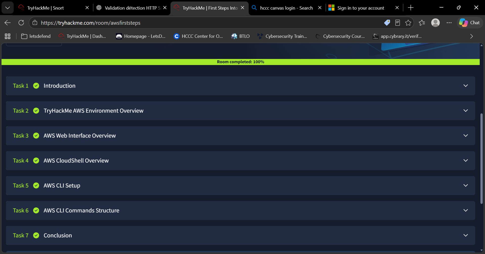
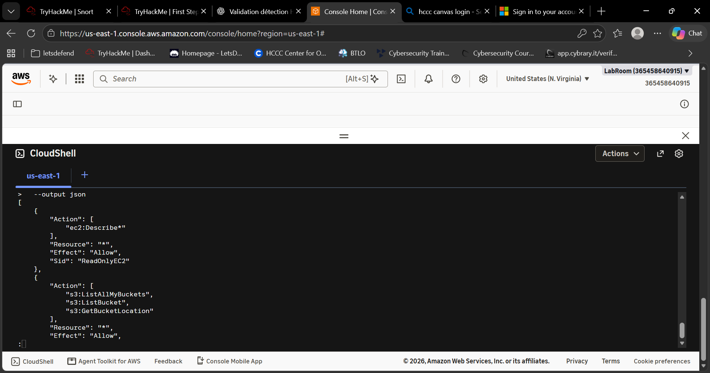
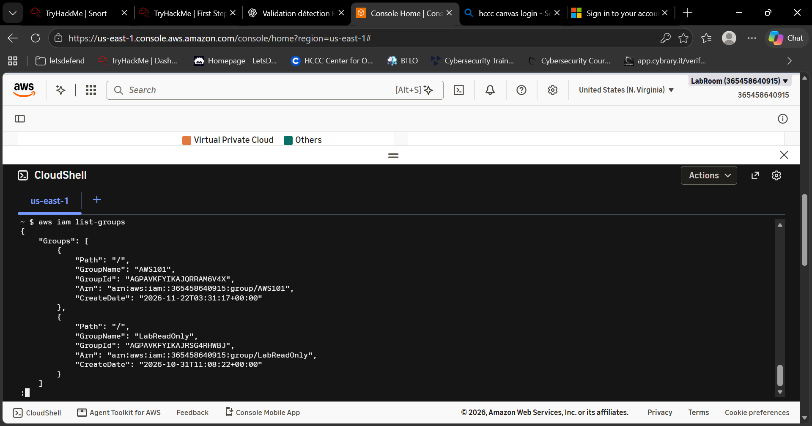
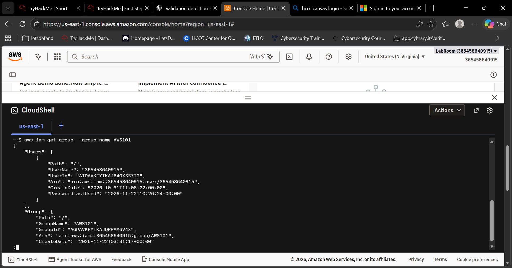
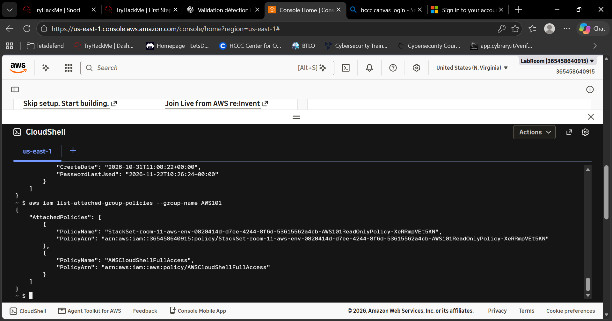
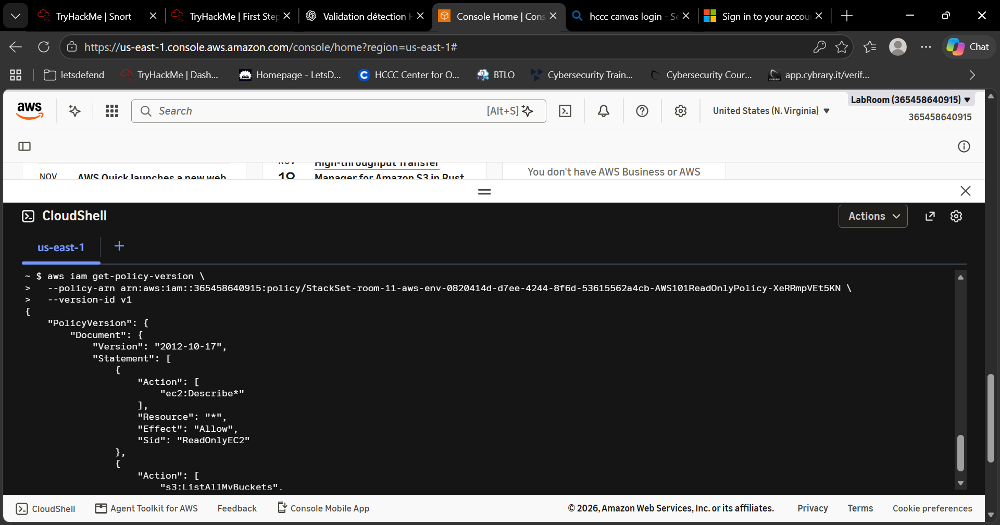
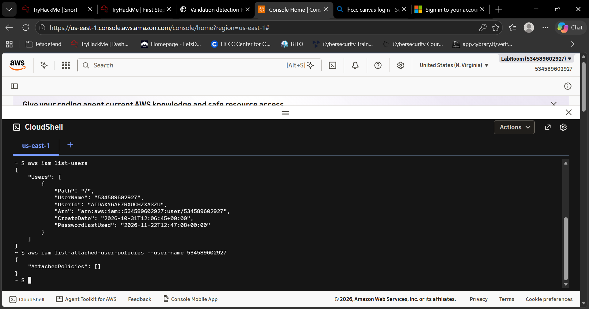

# AWS IAM Security Lab

## 1. Project Overview

This project documents my hands-on experience exploring AWS Identity and Access Management (IAM) through an authorized TryHackMe AWS lab environment.

The project focuses on using the AWS Command Line Interface (AWS CLI) to inspect IAM identities, groups, managed policies, and permission documents.

The objective was to understand how AWS identities receive permissions and how to examine IAM configurations from a security perspective.

## 2. Lab Environment

| Component | Details |
|---|---|
| Platform | TryHackMe |
| Cloud Provider | Amazon Web Services (AWS) |
| Interface | AWS Management Console |
| CLI Environment | AWS CloudShell |
| CLI Tool | AWS CLI |
| AWS Region | us-east-1 |
| Main Service | AWS IAM |

## 3. Project Objectives

During this lab, I practiced:

- Verifying AWS identities using AWS STS.
- Inspecting AWS CLI configuration.
- Listing IAM users and groups.
- Examining IAM group membership.
- Identifying managed policies attached to IAM groups.
- Distinguishing managed policies from inline policies.
- Retrieving IAM policy metadata.
- Analyzing IAM policy JSON documents.
- Checking policies directly attached to an IAM user.

## 4. AWS CLI Identity Verification

I used AWS Security Token Service (STS) to identify the AWS identity associated with my active CloudShell session.

**Command:**

```bash
aws sts get-caller-identity
```

This command returns information about the IAM user or role whose credentials are being used to make AWS API requests.

I also inspected the active AWS CLI configuration:

```bash
aws configure list
```

This helped me understand where the credentials and region configuration were coming from.

**Key learning:** Always verify the active AWS identity and configuration before performing administrative or security-related operations.

## 5. IAM Users and Groups Enumeration

I used AWS CLI to enumerate IAM users and groups in the lab account.

**Commands:**

```bash
aws iam list-users
```

```bash
aws iam list-groups
```

These commands provided visibility into the identities and groups configured in the AWS environment.

I also inspected the membership of the AWS101 group:

```bash
aws iam get-group --group-name AWS101
```

To identify the groups associated with a specific IAM user, I used:

```bash
aws iam list-groups-for-user --user-name LAB_USER_NAME
```

The observed lab user was associated with the following groups:

- AWS101
- LabReadOnly

**Security relevance:**

IAM group membership is important because permissions can be assigned through groups rather than directly to individual users.

## 6. IAM Group Policy Analysis

I inspected the managed policies attached to the AWS101 group.

**Command:**

```bash
aws iam list-attached-group-policies --group-name AWS101
```

The observed output included:

- AWS101ReadOnlyPolicy
- AWSCloudShellFullAccess

I also checked whether the group contained inline policies:

```bash
aws iam list-group-policies --group-name AWS101
```

The result returned an empty PolicyNames list.

This means that no inline policies were present in the group at the time of inspection. It does not mean that the group had no permissions, because managed policies were attached to it.

## 7. IAM Policy Metadata and Permission Analysis

I examined the metadata of the customer-managed policy AWS101ReadOnlyPolicy.

**Command:**

```bash
aws iam get-policy --policy-arn POLICY_ARN
```

I then retrieved the policy document:

```bash
aws iam get-policy-version \
  --policy-arn POLICY_ARN \
  --version-id v1
```

I reviewed the JSON structure and focused on the following IAM policy elements:

| Element | Meaning |
|---|---|
| Effect | Defines whether an action is allowed or denied |
| Action | Specifies the AWS API actions covered by the statement |
| Resource | Defines which resources the statement applies to |
| Sid | Provides an identifier for a policy statement |

### Observed EC2 Permissions

The policy included the following action:

```json
"Action": [
    "ec2:Describe*"
],
"Resource": "*",
"Effect": "Allow"
```

This statement allows matching EC2 Describe API actions.

### Observed S3 Permissions

The policy also included:

```json
"Action": [
    "s3:ListAllMyBuckets",
    "s3:ListBucket",
    "s3:GetBucketLocation"
],
"Resource": "*",
"Effect": "Allow"
```

These permissions allow the relevant bucket-listing and bucket-information operations.

The displayed statement did not include `s3:GetObject`, `s3:PutObject`, or `s3:DeleteObject`.

**Security observation:**

Examining the policy document provides more useful information than relying only on the policy name. The actual permissions are defined by the policy statements.

## 8. Direct IAM User Policy Inspection

I checked whether a managed policy was directly attached to the selected IAM user.

**Command:**

```bash
aws iam list-attached-user-policies --user-name LAB_USER_NAME
```

The observed result was:

```json
{
    "AttachedPolicies": []
}
```

This confirmed that no managed policy was directly attached to that user at the time of inspection.

However, an empty result does not mean that the user has no permissions.

The user may receive permissions through IAM group membership or inline policies.

This distinction is important when investigating IAM access.

## 9. Evidence and Screenshots

The following screenshots document the practical exercises completed during the lab.

### 01. First Steps Into AWS – Completion



### 02. AWS STS Identity Verification



### 03. IAM Group Enumeration



### 04. IAM Group Membership Inspection



### 05. Managed Policies Attached to an IAM Group



### 06. IAM Policy Version and Permission Document



### 07. Directly Attached IAM User Policies



## 10. Key Learnings

Through this lab, I developed practical familiarity with:

- AWS identity verification using STS.
- AWS CLI commands in CloudShell.
- IAM user and group enumeration.
- IAM group membership analysis.
- Managed and inline policy inspection.
- IAM policy JSON interpretation.
- Understanding the difference between direct user permissions and group-based permissions.

I also learned that an IAM investigation must consider multiple permission sources rather than relying on a single command or policy attachment result.

## 11. Scope and Limitations

This project documents an educational AWS lab exercise.

The activities focused primarily on read-only inspection of IAM identities, groups, and policies.

This was not a complete production AWS security audit.

The project does not claim that all effective permissions, permission boundaries, resource-based policies, service control policies, or session policies were evaluated.

The observations reflect the temporary TryHackMe lab environment used during the exercises.

## 12. Conclusion

This project provided hands-on experience with AWS IAM and AWS CLI.

I practiced identifying AWS identities, enumerating IAM users and groups, examining policy attachments, and interpreting JSON-based permission documents.

These exercises strengthened my understanding of AWS identity management, access control, and the importance of permission analysis in cloud security.

**Project Context:** Authorized educational cybersecurity training in the TryHackMe AWS lab environment.

## 13. References

- [AWS IAM Documentation](https://docs.aws.amazon.com/IAM/latest/UserGuide/introduction.html)
- [AWS IAM Policies and Permissions](https://docs.aws.amazon.com/IAM/latest/UserGuide/access_policies.html)
- [AWS Managed and Inline Policies](https://docs.aws.amazon.com/IAM/latest/UserGuide/access_policies_managed-vs-inline.html)
- [AWS STS GetCallerIdentity](https://docs.aws.amazon.com/cli/latest/reference/sts/get-caller-identity.html)
- [AWS CLI Command Reference](https://docs.aws.amazon.com/cli/latest/)
